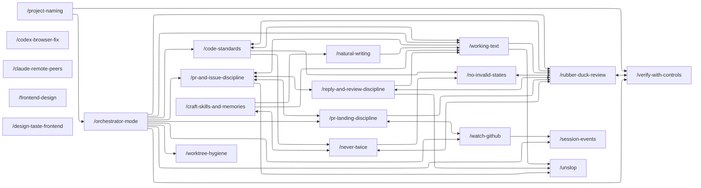

# Skills

[](https://github.com/Vivswan/skills/actions/workflows/ci.yml)

Skills for AI coding agents, installable with one command.

## Installation

One command installs this catalog and the three [upstream skills](#upstream-skills) through the skills CLI:

```bash
npx -y github:Vivswan/skills -g
```

Its flags pass through to each `npx skills add` it runs (`-g` for your user, `-a codex` for one agent), and `--help` prints the four commands without running them. One skill alone: `npx skills add Vivswan/skills -g --skill <name>`.

Or as a Claude Code plugin. The root [`.claude-plugin/marketplace.json`](./.claude-plugin/marketplace.json) publishes this catalog as the `vivswan-skills` plugin, and each upstream skill by its own name (`/plugin install unslop@vivswan-skills`):

```text
/plugin marketplace add Vivswan/skills
/plugin install vivswan-skills@vivswan-skills
```

Skills come first on Claude Code, Codex, and GitHub Copilot alike: each `SKILL.md` is the whole workflow, and the plugin manifests are optional ([the rules](./docs/authoring.md#compatibility-rules)).

## Available Skills

### Automatic

The agent applies these on its own when the task matches:

- [/code-standards](./skills/code-standards/SKILL.md) - Maintainability standards for code changes, folded into reviews
- [/codex-browser-fix](./skills/codex-browser-fix/SKILL.md) - Codex only: keeps the bundled Chrome plugin driving any Chromium browser (Chrome, Edge, Brave, Vivaldi, Opera) through app updates and custom model providers
- [/craft-skills-and-memories](./skills/craft-skills-and-memories/SKILL.md) - Create and repair skills and memories at their canonical source
- [/never-twice](./skills/never-twice/SKILL.md) - Climb every repeated failure to the most durable fix reachable
- [/no-invalid-states](./skills/no-invalid-states/SKILL.md) - Invariants in the type system instead of runtime checks
- [/pr-and-issue-discipline](./skills/pr-and-issue-discipline/SKILL.md) - PRs and issues that show the change instead of describing it
- [/project-naming](./skills/project-naming/SKILL.md) - A name for a project, package, or paper from one table of checked, scored candidates
- [/pr-landing-discipline](./skills/pr-landing-discipline/SKILL.md) - Draft flips, review rounds to convergence, line accounting, and a human-gated merge
- [/reply-and-review-discipline](./skills/reply-and-review-discipline/SKILL.md) - Plain-first replies to issue reporters and one pending review on someone else's PR
- [/rubber-duck-review](./skills/rubber-duck-review/SKILL.md) - Cross-model, read-only second-opinion code review
- [/session-events](./skills/session-events/SKILL.md) - One daemon per session delivers events from any polled source as messages in the peer envelope, quoting nothing from the polled system; the daemon behind /watch-github
- [/verify-with-controls](./skills/verify-with-controls/SKILL.md) - Controls and evidence before a zero, alarm, success claim, or stillness becomes a conclusion
- [/watch-github](./skills/watch-github/SKILL.md) - One daemon per session, a background task of that session, delivers PR comments, reviews, CI verdicts, head moves, and merges, and branch tips' CI, as messages instead of polls
- [/working-text](./skills/working-text/SKILL.md) - Working text a colleague scans to get work done, from a README or a comment to a PR or a diagram: shape rules, a paragraph-cap and path probe, and an architecture page that cannot rot
- [/worktree-hygiene](./skills/worktree-hygiene/SKILL.md) - Safe worktree removal, gated retirement of landed branches, explicit handovers, shared-repo rules

### Invoked by you

Load only when you invoke them (`/skill-name` in Claude Code, `$skill-name` in Codex):

- [/claude-remote-peers](./skills/claude-remote-peers/SKILL.md) - Message a Claude Code session on another machine over ssh: two socket forwards, no copies, pushed replies
- [/natural-writing](./skills/natural-writing/SKILL.md) - Prose without AI writing tells
- [/orchestrator-mode](./skills/orchestrator-mode/SKILL.md) - Parallel worktree subagents with gated landings, direct or PR-based

### Upstream skills

Skills written in other repositories. Nothing of them is copied here: the marketplace fetches each from its upstream's default branch, so an install is always upstream's latest, with upstream's own frontmatter.

- [/unslop](https://github.com/cursor/plugins/tree/HEAD/pstack/skills/unslop) - Cut AI tells from any writing (from [cursor/plugins](https://github.com/cursor/plugins))
- [/frontend-design](https://github.com/anthropics/skills/tree/HEAD/skills/frontend-design) - Distinctive visual design for new or reshaped UI (from [anthropics/skills](https://github.com/anthropics/skills))
- [/design-taste-frontend](https://github.com/Leonxlnx/taste-skill/tree/HEAD/skills/taste-skill) - Anti-slop frontend for landing pages, portfolios, and redesigns (from [Leonxlnx/taste-skill](https://github.com/Leonxlnx/taste-skill))

Each one alone, through the skills CLI:

```bash
npx skills add cursor/plugins/pstack/skills/unslop -g
npx skills add anthropics/skills/skills/frontend-design -g
npx skills add Leonxlnx/taste-skill/skills/taste-skill -g
```

How the skills reference each other (an arrow means "mentions and hands off to, where installed"):



## License

Individual and Small Organization License; the version and terms are in [LICENSE.md](./LICENSE.md).
