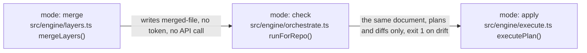

# The Architecture Page

The page kind with the most to rot: one layering declaration, the lint and the renderer that read it, one page whose every box names real code. The declaration cannot rot because a lint fails in both directions. The page cannot rot because a test checks every path, symbol, and demonstration link it names.

## The specimen

`architecture.yml` at the repository root. An example, from one repository's page (Vivswan/github-settings-as-code):

```yaml
layers:
  main: [src/main.ts]
  engine: [src/engine/]
  sections: [src/sections/]
  schema: [src/schema.ts]
  types: [src/types.ts]

exclude:
  - src/sections/*/mock.ts
  - "src/**/*.test.ts"

# from -> the layers it may import; a layer absent here imports nothing outside itself.
edges:
  main: [engine]
  engine: [schema, sections, types]
  sections: [engine, schema, types]
  schema: [sections, types]
```

One concept diagram from that same example page, with the fact it cannot show and its demonstration line. The `Demonstrated by:` links are that repository's own tests:

````markdown
## The mode ladder



Each rung is safe to run before the next, and moving a file up the ladder changes nothing about the file.

- Apply executes the plan. Under the default `on-missing-permission: fail`, a read-only preflight over the active sections runs first and refuses to write anything when one is denied.

Demonstrated by: [test/engine/check-purity.test.ts](https://github.com/Vivswan/github-settings-as-code/blob/main/test/engine/check-purity.test.ts), [test/engine/layers.test.ts](https://github.com/Vivswan/github-settings-as-code/blob/main/test/engine/layers.test.ts).
````

The page header says what the checks prove: existence only. A caption-only box (`mode`, `merged-file`) names no file and is not checked. A demonstration link is checked to resolve, not to test the claim above it.

## The recipe

The three commands ship with the `/working-text` skill under `scripts/architecture/`, beside the readers they share. Copy that folder and `package.json` into a folder of the repository's own, so its check command runs without the skill installed; `<scripts-dir>` below is the copied `scripts/architecture/`.

The output prefixes keep the old command names: `arch-lint:`, `render-architecture-map:`, `check-architecture-page:`.

```bash
mkdir -p <tools-dir>/working-text/scripts
cp -r "<skill-dir>/scripts/architecture" <tools-dir>/working-text/scripts/
cp "<skill-dir>/package.json" <tools-dir>/working-text/
```

The copy keeps `scripts/` between the folder and `architecture/`: on first run each command bundles itself with its dependencies into a `.build` folder beside the `scripts/` that has `package.json` next to it. Add `.build/` to the repository's `.gitignore`.

The commands below use `<docs>/architecture.md` for the page. Put it wherever the repository keeps its pages.

A repository whose `tsc` includes the copied scripts also adds the pins of the copied `package.json` as exact devDependencies: the types resolve from its `node_modules`, the run from the bundle.

### 1. Declare the layers, then make the lint pass

- Write `architecture.yml`: `layers` (name to paths, a trailing slash marking a directory), `exclude` (test fragments, fixtures), `edges` (from-layer to the layers it may import).
- Type-only imports count as edges. So does any `require(...)` call, including one bound locally as `createRequire(import.meta.url)`, which does load modules. Imports inside one layer are not edges.
- `exclude` removes a file as a source only. An import into an excluded file is still an edge.
- Only relative specifiers are read. A path alias is invisible to the lint, so declare the tree, not the alias.
- Run the lint and fix until it prints the match line:

```bash
bun <scripts-dir>/lint.mts --root .            # exit 0: arch-lint: imports under src match architecture.yml
```

```text usage=skills/working-text/scripts/architecture/lint.mts
usage: lint.mts [--config <architecture.yml>] [--root <dir>] [--mermaid]
  --config   the layering declaration (default: <root>/architecture.yml)
  --root     the repository root the paths are relative to (default: cwd)
  --mermaid  print the module map instead of linting
exits: 0 the tree matches the declaration; 1 forbidden or stale edges; 2 usage or an unreadable graph
```

| Message | What to do |
| --- | --- |
| `forbidden import a -> b: src/a/x.ts -> src/b/y.ts; move it or declare the edge` | Move the import, or add `b` under `edges.a` when the dependency is right |
| `stale allowance a -> b: no file draws it; remove it from architecture.yml` | Delete `b` from `edges.a`. The declaration lists only edges the code draws |
| `src/z.ts belongs to no layer in architecture.yml` | Add the file to a layer or to `exclude`. Nothing is silently dropped |
| `src/a/x.ts:12 loads a module through a computed specifier ...` (exit 2) | Rewrite `import(name)` with a string literal. The graph cannot follow a variable |

### 2. Give the page a generated region and render the map

Put this under the page's last heading. The markers stay, the body is the script's:

```markdown
## The module map

Each node is one layer, labelled with the paths it owns; an arrow means the layer imports the other. Rendered from `architecture.yml`; the lint keeps that declaration equal to the import graph.

<!-- BEGIN GENERATED: architecture-map (bun render-map.mts; derived from architecture.yml) -->
<!-- END GENERATED: architecture-map -->
```

```bash
bun <scripts-dir>/render-map.mts --page <docs>/architecture.md          # writes the fence
bun <scripts-dir>/render-map.mts --page <docs>/architecture.md --check  # exit 1 on drift, for CI
```

```text usage=skills/working-text/scripts/architecture/render-map.mts
usage: render-map.mts --page <path> [--config <architecture.yml>] [--root <dir>] [--region <name>] [--check]
  --page     the markdown page carrying the generated region
  --config   the layering declaration (default: <root>/architecture.yml)
  --root     the repository root (default: cwd)
  --region   the generated region's name (default: architecture-map)
  --check    exit 1 when the committed region differs, instead of rewriting it
exits: 0 written or already current; 1 drift under --check; 2 usage, no region, or an unreadable declaration
```

### 3. Author the concept diagrams, box by box, against real symbols

One hand-authored mermaid flowchart per concept, above the module map. Rules per box and per diagram:

- A box that names a file lists the exported symbols it means: `src/engine/layers.ts<br>stripNulls() mergeLayers()`. Open the file and copy the names, never write one from memory.
- The exported name counts, so `export { oldName as newName }` exports `newName`, a default export is `default()`, and `export * from` carries the target's names.
- An edge label that carries brackets or parentheses (`run()`) is quoted or in the `|...|` form: `-- "run()" -->` or `-->|run()|`.
- A caption-only box is allowed (`mode`, `the live repository`). A box that mixes prose after a path is read as symbols and fails.
- Quote every label. The check cannot read an unquoted one and says so.
- Under a diagram, only what it cannot show (the reason, the invariant, the consequence), in whatever form carries it. A diagram that says everything gets nothing.
- A bullet that restates an arrow is deleted. It fails the test `/code-standards` applies to comments: what does this say that the picture does not?
- Close with `Demonstrated by:` and links to the test or e2e scenario that covers the concept, as repository URLs or paths relative to the page.

### 4. Add the page test

Run the check with the diagram count pinned, where `<n>` is the number of concept diagrams on the page. The count changes only when a diagram is added or removed on purpose:

```bash
bun <scripts-dir>/check-page.mts --page <docs>/architecture.md \
  --repo-url https://github.com/<owner>/<repo>/blob/main/ --expect-diagrams <n>
# exit 0: check-architecture-page: <docs>/architecture.md names real code (concept diagrams: <n>)
```

```text usage=skills/working-text/scripts/architecture/check-page.mts
usage: check-page.mts --page <path> [--root <dir>] [--repo-url <prefix>] [--expect-diagrams <n>]
  --page             the architecture page to check
  --root             the repository root the label paths are relative to (default: cwd)
  --repo-url         the URL prefix an absolute demonstration link maps onto the root with
                     (e.g. https://github.com/owner/repo/blob/main/); relative links resolve from the page
  --expect-diagrams  the number of concept diagrams the page must carry
exits: 0 the page names real code; 1 problems, each printed; 2 usage or an unreadable page
```

| Message | What to do |
| --- | --- |
| `"<label>": src/engine/nowhere.ts does not exist` | The file moved or the path is mistyped. Fix the box |
| `"<label>": src/engine/layers.ts exports no foldAll` | The symbol was renamed or never exported. Fix the box, not the file |
| `"<label>": "srcc/engine/x.ts" looks like code but reads as a caption` | The first path segment is not a top-level directory. Fix the typo |
| `line 41: the diagram has no "Demonstrated by:" line before the next heading` | Add the line with a link to the covering test |
| `expected <n> concept diagrams, found <n-1>` | A diagram vanished, or you added one: update `--expect-diagrams` in the same change |

Repositories that already have a bun test suite can import the same functions instead: `diagramProblems`, `conceptCounts`, `lintArchitecture`, `renderArchitectureMermaid` are exported by the scripts.

### 5. Wire the gates

The lint, the renderer, and the page check run inside the repository's check command and, where the repository publishes a docs site, the page is part of it. The entries, shown for a `package.json`:

```json
{
  "scripts": {
    "lint:arch": "bun <scripts-dir>/lint.mts --root .",
    "build:docs": "bun <scripts-dir>/render-map.mts --page <docs>/architecture.md",
    "build:check": "bun <scripts-dir>/render-map.mts --page <docs>/architecture.md --check",
    "test:docs": "bun <scripts-dir>/check-page.mts --page <docs>/architecture.md --repo-url https://github.com/<owner>/<repo>/blob/main/ --expect-diagrams <n>"
  }
}
```

Add `lint:arch`, `test:docs`, and `build:check` to the repository's existing check command, whatever its toolchain.

## Maintaining the page after a change

- Code moved across layers: run the lint, which names the edge to declare or the import to move. Then re-render the map and commit both.
- A symbol renamed: the page check names the box. Fix the box in the same change as the rename.
- A concept added: a new H2, its diagram, its demonstration line, and `--expect-diagrams` plus one.
- Never edit between the GENERATED markers. The drift check rejects it and the next render overwrites it.

## What a review checks

- A box names a symbol its file does not export, or a path that does not exist (run `check-page.mts` rather than trusting the diff).
- The module map shows an edge the code does not draw, or was edited by hand inside the GENERATED region (run `lint.mts` and `render-map.mts --check`).
- A concept diagram has no `Demonstrated by:` line, or its link does not resolve to a test or scenario.
- Bullets under a diagram restate the arrows instead of stating what the diagram cannot show.
- The change moved code across layers without touching `architecture.yml`, or added an allowance no import draws.
- The page header no longer says the checks prove existence only.
